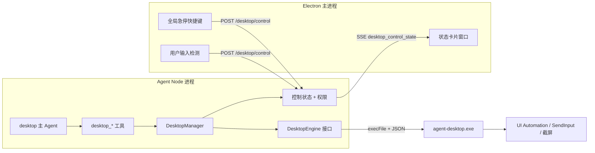

# Desktop Agent：调研结论与实施计划

状态：设计中，待实施（2026-11-02）

## 1. 目标

在 Baize 桌面版里新增一个 `desktop` 主 Agent，让它能像人一样操作 Windows 桌面程序：看界面、点击、输入、滚动、切换窗口，并且全程可见、可暂停、可审计。第一期只做 Windows，接口按跨平台设计，以后再加 macOS。

## 2. 调研结论

### 2.1 Computer Use 的基本原理

所有同类产品本质上都是一个循环：

1. **观察**：读取界面，可以是截图，也可以是系统无障碍接口提供的控件树。
2. **决策**：模型根据任务和观察结果，输出一个动作，比如点击某个元素、输入一段文字。
3. **执行**：本地程序调用操作系统接口执行这个动作。
4. **再观察**：确认结果，然后回到第 2 步，直到任务完成。

模型本身不能直接操作电脑，必须由本地的辅助程序代为执行。

### 2.2 成熟产品的做法

- **Cursor**：
  - 云端 Agent 跑在隔离的虚拟机里，用鼠标键盘操作桌面，用户可以接管。
  - 自托管机器上，用 `--computer-use` 显式开启。macOS 上下载一个单独签名的辅助程序，由用户授予“辅助功能”和“屏幕录制”权限；Linux 上用 X11 加 `xdotool` 和 `ffmpeg`。
  - 企业管理员可以统一关闭这个功能。
- **Claude computer use、UI-TARS**：截图加坐标点击。截图要缩放到适合模型的尺寸，坐标再换算回屏幕坐标。
- **OpenAI Operator / ChatGPT agent**：提交、付款、发送之前必须让用户确认；遇到登录和验证码就交给用户；用户可以随时接管。
- **vercel agent-desktop、OpenDesk**：优先读系统无障碍树，每个元素有一个稳定的 ref，按 ref 操作，操作完重新快照确认结果，不靠猜像素坐标。
- **zavora computer-use-mcp**：屏幕上有状态卡片，带暂停和停止；`Ctrl+Alt+Esc` 急停；用户一动鼠标键盘就自动暂停；状态卡片不出现在 Agent 自己的截图里。
- **Agent-S**：先规划再执行；失败了换一条路，不在原地重试同一个动作。

综合出的设计原则：**控件树优先，截图兜底；一切操作可见、可暂停、可审计。**

### 2.3 开源项目对比

| 项目 | 类型 | 许可证 | 结论 |
|---|---|---|---|
| [vercel-labs/agent-desktop](https://github.com/vercel-labs/agent-desktop) | 底层引擎，Rust CLI 加 C 库，Windows / macOS / Linux | Apache-2.0 | **首选引擎** |
| [opensymph/open-computer-use](https://github.com/opensymph/open-computer-use) | 底层引擎，MCP 服务器加 CLI；Windows 和 Linux 用 Go，macOS 用 Swift | MIT | **备选引擎**，只能用 MIT 时选它 |
| [CursorTouch/Windows-MCP](https://github.com/CursorTouch/Windows-MCP) | MCP 服务器，只支持 Windows | MIT | 依赖 Python 3.14，打包太重，只适合做原型 |
| [vectora-foundry/native-devtools-mcp](https://github.com/vectora-foundry/native-devtools-mcp) | MCP 服务器，支持 Windows 和 macOS | MIT | 规模小，代码适合学习参考 |
| [bytedance/UI-TARS-desktop](https://github.com/bytedance/UI-TARS-desktop) | 完整 Agent 应用 | Apache-2.0 | 自带决策循环，会和 Baize 冲突，只参考思路 |
| [simular-ai/Agent-S](https://github.com/simular-ai/Agent-S) | 完整 Agent 框架 | Apache-2.0 | 同上 |
| [trycua/cua](https://github.com/trycua/cua) | 虚拟机和沙箱基础设施 | 大部分 MIT | 解决的是隔离问题，不负责操作用户本机 |
| [microsoft/OmniParser](https://github.com/microsoft/OmniParser) | 把截图解析成可点击元素 | — | 纯视觉兜底时可以参考 |

### 2.4 Windows 底层接口（自研时需要用到）

- **键盘鼠标**：`SendInput`。鼠标用绝对坐标加 `MOUSEEVENTF_VIRTUALDESK`；文字用 `KEYEVENTF_UNICODE`，中文不受输入法影响。
- **操作控件**：UI Automation 的控件接口，比如 Invoke、Value、Toggle、ExpandCollapse、SelectionItem。不需要移动鼠标，也不抢焦点。
- **截图**：
  - 整屏：DXGI Desktop Duplication；
  - 单个窗口：`PrintWindow(PW_RENDERFULLCONTENT)`；
  - 兜底：GDI `BitBlt`；
  - Win11 上可以用 `Windows.Graphics.Capture`。Win10 用它会出现黄色边框。
- **OCR**：`Windows.Media.Ocr`，系统自带，离线可用。
- **识别用户真实输入**：低级钩子 `WH_MOUSE_LL` / `WH_KEYBOARD_LL`，用 `LLMHF_INJECTED` 标志区分 Agent 注入的输入和用户的真实输入。
- **DPI**：Per-Monitor V2 DPI 感知，所有坐标按物理像素处理。
- **硬边界**：操作不了“以管理员身份运行”的窗口；UAC 弹窗、锁屏等安全桌面完全无法访问。

### 2.5 许可证调研

- agent-desktop 的 LICENSE 是标准 Apache-2.0 全文，没有附加条款；项目 FAQ 写明个人和商业使用都可以。
- **待法务确认**：公司政策是否允许 Apache-2.0。注意，项目现在已经依赖多个 Apache-2.0 组件：

  | 依赖 | 许可证 |
  |---|---|
  | `ai`（Vercel AI SDK，Agent 核心框架） | Apache-2.0 |
  | `playwright-core`（浏览器自动化） | Apache-2.0 |
  | `sharp`（图片处理） | Apache-2.0 |
  | `typescript` | Apache-2.0 |
  | `@modelcontextprotocol/sdk`、`electron` | MIT |

- 如果只能用 MIT 或 BSD，那么 Rust crate 里 `uiautomation`（Apache-2.0）和 `xcap`（Apache-2.0）也不能用。只能用 `windows`（MIT 和 Apache-2.0 双许可证，可选 MIT）和 `enigo`（MIT）。
- 使用 agent-desktop 需要做到：
  - 在安装包里附上它的 LICENSE 和 NOTICE；
  - 在第三方声明里写明使用了它；
  - 不用 Vercel 的商标宣传；
  - 用 `cargo about` 或 `cargo deny` 扫一遍它的间接依赖，确认没有 GPL 一类的许可证。

## 3. 选型决定

| 方案 | 新增代码量 | 优点 | 风险 |
|---|---|---|---|
| **A. agent-desktop 做引擎**（推荐） | 约 5000–8000 行，不写 Rust | 成熟度最高；ref、错误、快照的设计和我们的浏览器模型一致；自带跨平台 | 许可证待确认；项目更新快；Windows 上的成熟度和延迟需要实测 |
| B. open-computer-use 做引擎 | 约 5000–8000 行 | MIT；内置护栏 | 更新、用户少，Windows 兼容性需要更多实测 |
| C. 完全自研 Rust sidecar | 约 1.8 万–2.8 万行 | 完全可控 | 各种程序的兼容问题要自己一个个踩，需要几个月打磨 |

**决定**：许可证允许就选 A；只允许 MIT 就选 B。无论选哪个，引擎都放在 `DesktopEngine` 接口后面，以后可以替换，也可以逐步换成自研。

参照数据：现有浏览器子系统约 1.9 万行（`src/browser/` 约 1.09 万行，`BrowserTool` 约 2600 行，Chrome 扩展约 1100 行，测试约 4900 行）。

## 4. 架构

结构上照着现有浏览器子系统：`src/browser/` 对应 `src/desktop/`，`src/tools/BrowserTool/` 对应 `src/tools/DesktopTool/`。

## 5. 引擎接入（agent-desktop）

- **开发和 CI**：作为 npm 的 `devDependencies` 安装，包里自带 x64 和 ARM64 原生程序。
- **正式安装包**：新增 `scripts/stage-agent-desktop.cjs`，参照 `scripts/stage-ripgrep.cjs`。它从 GitHub Releases 下载锁定版本的程序，校验 sha256，解压到 `dist/desktop-resources/agent-desktop/`（辅助程序和主程序放在同一目录），附上 LICENSE，再通过 `desktop/electron-builder.config.cjs` 的 `extraResources` 打进安装包。
- **可信路径**：在 `desktop/agent-launch.mjs` 里，打包后只从 `resourcesPath` 解析程序路径，设置 `BUNDLED_AGENT_DESKTOP_PATH`，忽略继承来的同名环境变量，做法和 `BUNDLED_RG_PATH` 一样。不回退到 PATH。
- **版本校验**：启动时执行 `agent-desktop version`，和 manifest 对比，同时检查返回 JSON 里的 `version` 字段。主版本号不一致就禁用 desktop 工具。
- **调用方式**：
  - 用 `execFile` 传参数数组，不经过 shell；
  - 每个会话串行执行；
  - 超时或用户中止时杀掉整个进程树；
  - 多步操作用 `batch` 合并。
- **错误映射**：把 `error.code`、`suggestion` 和“能否安全重试”的标记，转成统一的“Error 加 Recovery action”工具文本。
- **真实输入**：默认关闭。只有坐标点击这类工具才加 `--headed`。
- **使用说明同步**：参照 `scripts/sync-echarts-skill.cjs`，在构建时用 `agent-desktop skills get desktop` 和 `skills get platform` 拉取它的使用说明，合并进 `desktop.md`。

## 6. 工具设计

| 类别 | 工具 |
|---|---|
| 只读 | `desktop_windows`（list）、`desktop_snapshot`、`desktop_find`、`desktop_screenshot`、`desktop_wait_for` |
| 改动界面 | `desktop_windows`（focus / launch / close）、`desktop_click`、`desktop_type`、`desktop_set_value`、`desktop_select`、`desktop_toggle`、`desktop_expand`、`desktop_press_key`、`desktop_scroll`、`desktop_drag`、`desktop_mouse_click_xy` |
| 控制权 | `desktop_lock` |

- 快照输出成和 `browser_snapshot` 一致的 YAML 加 ref，提示词可以大量复用 `.ai-agent/agents/browser.md`。
- 复杂程序先用 `--skeleton` 看整体结构，再用 `--root` 展开局部。
- 改动界面的工具执行完，自动附带一份新的精简快照。
- `desktop_mouse_click_xy` 必须带最近一次截图的 id，用这张图的缩放比例换算坐标。
- 识别到浏览器窗口时，提示改用 `browser_*` 工具。

## 7. 控制权、安全与审计

- **默认关闭**：沿用 `src/browser/enablement.ts` 的模式，`desktop_*` 默认被 deny。只有同时满足三个条件才启用：
  - 当前是 `desktop` 主 Agent，或者设置了 `desktop.enabled: true`；
  - 平台是 win32；
  - 运行在 desktop 运行时。
- **状态卡片**：Electron 里一个置顶、无边框、默认点击穿透的窗口，显示“Baize 正在使用你的电脑”、当前步骤、暂停和停止按钮。调用 `setContentProtection(true)`，让它不出现在 Agent 的截图里。
- **急停**：`globalShortcut` 注册急停快捷键，默认 `Ctrl+Alt+Esc`，可配置。
- **用户一动就暂停**：
  - 第一版在 Electron 里每秒轮询 `powerMonitor.getSystemIdleTime()`，空闲时间归零就说明用户在操作。agent-desktop 默认不注入真实输入，所以不会被自己误触发；`--headed` 动作执行期间忽略这个信号。
  - 暂停后复用 `src/browser/active-browser-tools.ts` 的模式，中止正在执行的改动类工具。
- **状态推送**：在 `protocol/src/server.ts` 新增 `system` 消息，subtype 为 `desktop_control_state`，经 `src/services/session-live-hub.ts` 推送，不再像浏览器那样轮询。
- **按程序授权**：改动界面的工具实现 `checkPermissions`。第一次操作某个程序时询问用户，选项是“本会话 / 始终 / 拒绝”。默认黑名单包括密码管理器、终端和系统安全设置。
- **防提示词注入**：屏幕上的文字是数据，不是指令。提交、发送、删除、付款之前必须确认。不猜密码，登录、验证码、2FA、UAC 交给用户。
- **审计**：每一步的动作、目标元素和截图缩略图，写入 `{agentHome}/.ai-agent/desktop-logs/<sessionId>/`。Web 端提供时间线回放。

## 8. 需要改动的现有文件

- `src/constants/tool_names.ts`：新增 `DESKTOP_*` 常量；只读工具并入 `READ_ONLY_TOOLS`，改动类工具并入 `PLAN_MODE_DENIED_TOOLS`。
- `src/tools.ts`：注册 `desktopToolDefinitions`。
- `src/tools/assembleToolPool.ts`：
  - 加上 desktop 的 deny glob；
  - 把现在写死只提升 `BROWSER_TOOL_NAMES` 的逻辑，泛化成“按主 Agent 类型取工具族”。
- `src/services/compact/microCompact.ts`、`src/services/tokenEstimation.ts`、`src/utils/project-tool-use-result.ts`：在出现 `BROWSER_TOOL_NAMES` 的地方同时纳入 desktop 工具。
- `src/tests/test-coding-tools-manifest.ts`：把 desktop 工具加入排除列表。
- `src/core/settings-schema.ts`、`src/core/settings-manager.ts`：新增 `desktop` 配置。
- `src/server/routes/capabilities.ts`：新增 `desktopAutomation` 能力开关。
- `src/server/router.ts`：新增 `/desktop/control` 路由。
- `desktop/main.mjs`、`desktop/preload.cjs`、`desktop/agent-launch.mjs`：状态卡片、急停快捷键、用户输入检测、程序路径。
- `desktop/electron-builder.config.cjs`、`package.json`：打包和 staging 脚本。
- 新增 `.ai-agent/agents/desktop.md`，并拷贝到 `deploy/desktop/workspace-seed/.ai-agent/agents/`，加入选择器的 primaries 列表。
- `.github/workflows/ci.yml`：新增 `windows-latest` 任务。

## 9. 分阶段计划

**第 0 阶段：引擎验证，1 到 2 天（明天开始）**

- 在本机安装 agent-desktop 和 open-computer-use，在同一组任务上对比：
  - 记事本：新建、输入中文、保存；
  - 资源管理器：进入目录、重命名文件；
  - 计算器：计算并读出结果；
  - 系统设置：找到某个开关并读出状态；
  - Excel 或 WPS：在单元格里写值；
  - 微信或钉钉：只读，列出最近的会话。
- 记录四项指标：任务成功率、每步延迟、快照占多少 token、出错后能否恢复。
- 同时确认这些问题：
  - Windows 版 Release 压缩包里的文件和辅助程序名称；
  - npm 包是怎么分发各平台程序的；
  - Windows 上有没有常驻进程复用；
  - `docs/json-output.md` 里的完整错误码。
- 产出：选型结论和一份实测记录，补充到本文档。

**第 1 阶段：核心链路，约 1 周**

- `src/desktop/`：`types.ts`、`engine/`（`DesktopEngine` 接口和 agent-desktop 实现）、`manager.ts`、`enablement.ts`。
- `src/tools/DesktopTool/`：`defineDesktopTool` 包装，加上只读工具和基础操作工具。
- 工具注册、配置 schema、`desktop.md`。
- 验收标准：在 Baize 里对 desktop Agent 说“打开记事本，写一段话并保存到桌面”，能完成。

**第 2 阶段：稳健性和兜底，约 1 周**

- 截图缩放和坐标点击、编号截图（复用 `src/browser/screenshot-annotate.ts`）、等待、ref 失效处理、超时恢复、浏览器窗口转交提示。

**第 3 阶段：控制与安全，约 1 到 2 周**

- 状态卡片、急停快捷键、用户一动就暂停、SSE 推送、按程序授权、黑名单、审计时间线、Web 控制条。

**第 4 阶段：发布，约 1 周**

- staging 脚本、可信路径、签名打包、Windows CI、`test:desktop` 真机测试、20 到 30 个任务的评测集。

**以后：macOS**

- 授权引导（“辅助功能”，可能还要“屏幕录制”）、签名和公证、`darwin-x64` / `darwin-arm64` 打包。

## 10. 待决事项

- [ ] 法务确认 Apache-2.0 是否允许使用（决定用方案 A 还是 B）。
- [ ] 第 0 阶段的实测结果。
- [ ] 准备代码签名证书（Windows 安装包和引擎程序都要签名，否则容易被杀毒软件拦截）。
- [ ] 默认急停快捷键和默认黑名单程序清单。
